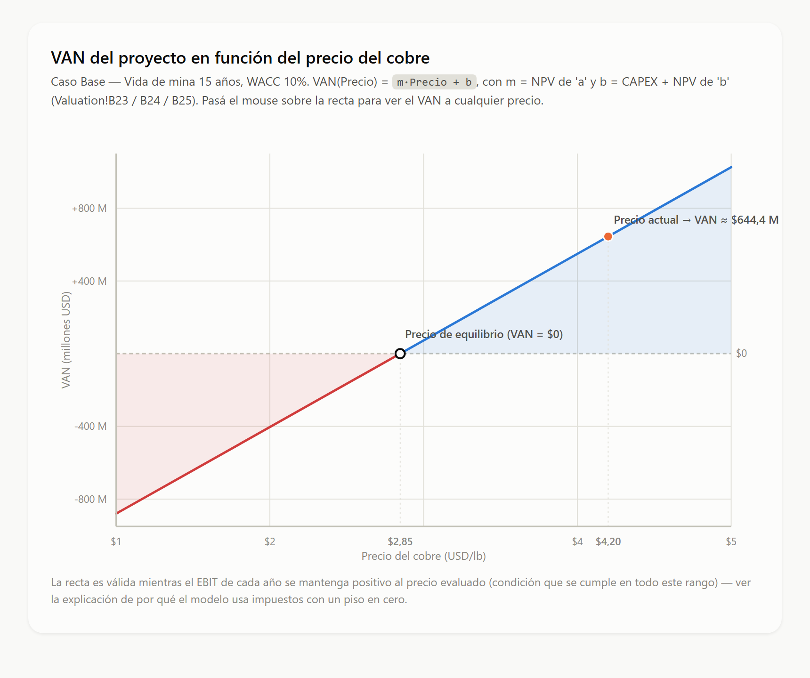
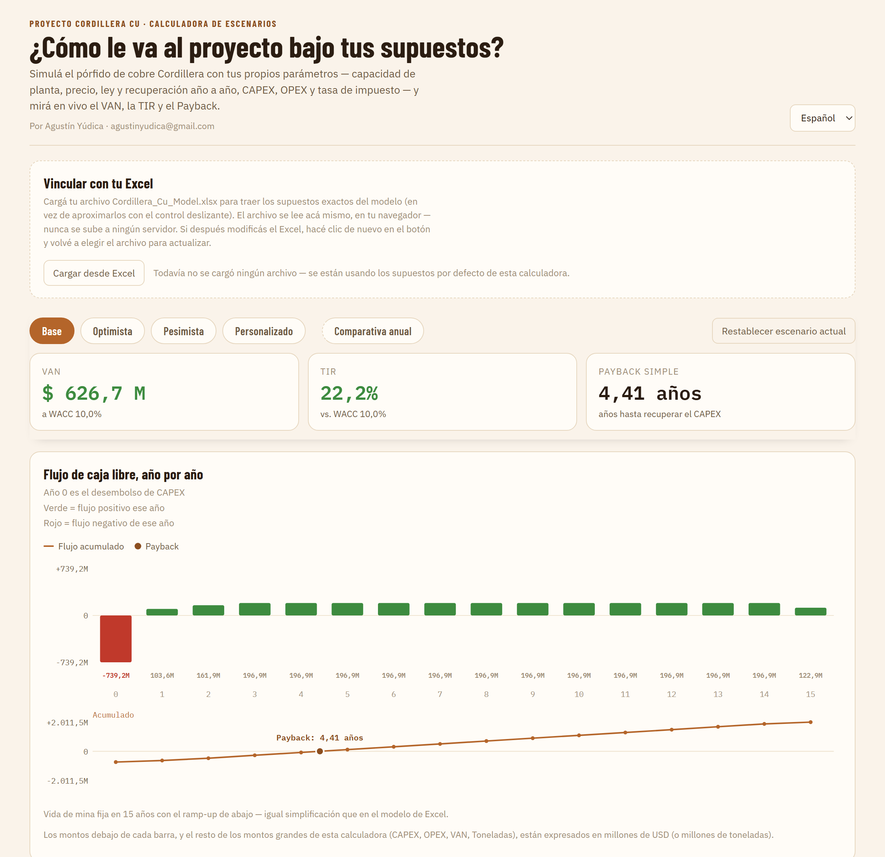
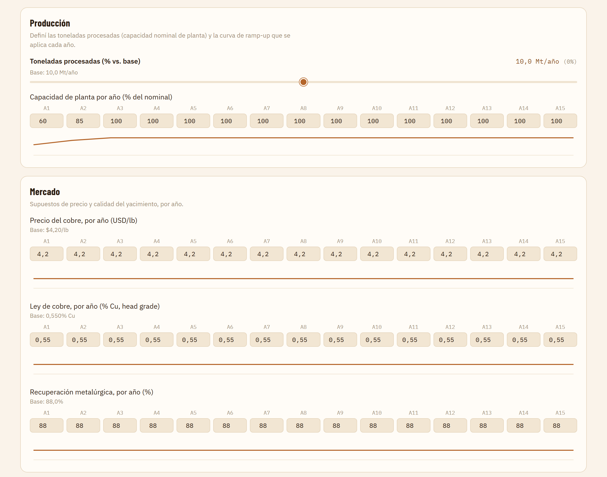
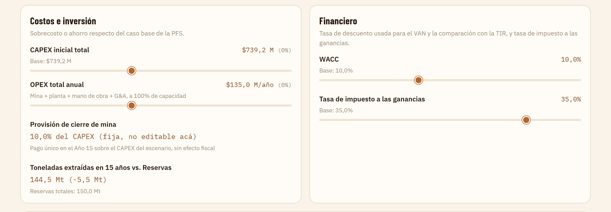
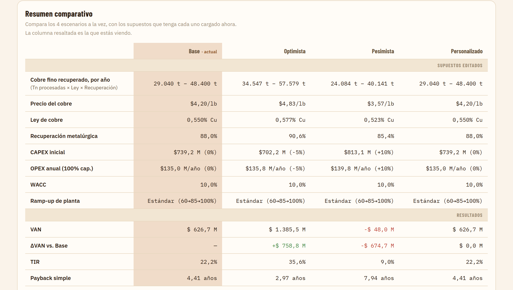

# Calculadora Cordillera Cu

Modelo económico-financiero de un proyecto minero de cobre **ficticio** ("Cordillera Cu"), acompañado de una guía técnica de minería pensada para profesionales de negocios y ciencias económicas.

> ⚠️ **Caso educativo.** Ningún dato corresponde a un yacimiento real. Los precios, costos, leyes y reservas son supuestos ilustrativos.

## Contenido del repositorio

| Archivo | Descripción |
|---|---|
| [`Cordillera_Cu_Model.xlsx`](Cordillera_Cu_Model.xlsx) | Modelo de evaluación del proyecto (etapa de prefactibilidad, PFS): producción, ingresos, OPEX, CAPEX, impuestos, flujo de caja y valuación. |
| [`Grafico precio de equilibrio.html`](Grafico%20precio%20de%20equilibrio.html) | Gráfico interactivo del VAN del proyecto en función del precio del cobre, con el precio de equilibrio (VAN = 0). Se abre directamente en el navegador. |
| [`Informe Tecnico Minero .docx`](Informe%20Tecnico%20Minero%20.docx) | *Minería para profesionales de negocios*: guía práctica que explica la actividad minera desde cero, con banco de preguntas resueltas y glosario. |
| [`Técnico Minero.pdf`](T%C3%A9cnico%20Minero.pdf) | Material del curso Técnico Minero en el que se basa la guía. |

## El proyecto Cordillera Cu

| Parámetro | Valor |
|---|---|
| Commodity | Cobre (Cu) |
| Producto de venta | Concentrado de cobre (no cátodos), vendido a fundición mediante contrato *off-take* |
| Región | Cuyo, Argentina (ficticio) |
| Etapa | Prefactibilidad (PFS) |
| Moneda / unidades | USD / sistema métrico |

### Estructura del modelo Excel

1. **Cover** – Portada y datos generales del proyecto.
2. **Assumptions** – Única hoja con valores tipeados a mano. El resto del modelo toma todo por referencia desde acá (no hay números *hardcodeados* en otras hojas).
3. **Production** – Toneladas procesadas → metal contenido → metal recuperado → metal pagable (ley, recuperación metalúrgica y *payability*).
4. **Revenue** – Ingresos por venta de concentrado, descontando *Treatment Charges* (TC) y *Refining Charges* (RC).
5. **OPEX** / **OPEX Detail** – Costos operativos de mina, planta y G&A, separando costos variables (USD/t) y fijos (USD/año).
6. **CAPEX** / **CAPEX Detail** – Inversión inicial (mina, planta, infraestructura, EPCM y contingencia) desagregada por componente.
7. **Taxes** – Impuesto a las ganancias simplificado, con piso en cero.
8. **Cash Flow** – Flujo de caja libre del proyecto, incluyendo provisión de cierre de mina.
9. **Valuation** – VAN y métricas de valuación descontadas al WACC.
10. **Sensitivities** – Sensibilidad del resultado a las variables clave.
11. **Scenarios** – Comparación de escenarios.
12. **Dashboard** – Resumen visual de los resultados.

### Resultados del caso base

Con una vida de mina de 15 años, un WACC del 10% y un precio del cobre de USD 4,20/lb (hoja *Valuation*):

| Indicador | Valor |
|---|---|
| VAN (Valor Actual Neto) | ≈ USD 740,4 M |
| TIR (Tasa Interna de Retorno) | 25,68% |
| Payback simple | 3,75 años |
| CAPEX inicial | USD 739,2 M |
| Precio de equilibrio del cobre (VAN = 0) | USD 2,75/lb |

Mientras el EBIT de cada año sea positivo, el VAN es lineal respecto del precio:
`VAN(Precio) = m · Precio + b`, con `m` y `b` tomados de la hoja *Valuation*.

## Capturas

### Gráfico interactivo: VAN vs. precio del cobre

### Calculadora de escenarios

Versión web e interactiva del modelo. Permite simular el proyecto con supuestos propios (capacidad de planta, ramp-up, precio, ley y recuperación año a año, CAPEX, OPEX, WACC y tasa de impuesto) y recalcula en vivo el VAN, la TIR y el payback. Trae cuatro escenarios predefinidos (Base, Optimista, Pesimista y Personalizado), está disponible en español e inglés y puede leer los supuestos directamente desde `Cordillera_Cu_Model.xlsx`. El archivo se procesa en el navegador y no se sube a ningún servidor.

**Indicadores y flujo de caja libre año por año.** Muestra el VAN, la TIR y el payback del escenario seleccionado, el flujo de caja de cada año (el año 0 es el desembolso de CAPEX) y el flujo acumulado, con el punto de payback marcado.

**Producción y mercado.** Capacidad nominal de planta, curva de ramp-up y precio, ley y recuperación metalúrgica editables para cada uno de los 15 años.

**Costos, inversión y parámetros financieros.** Sobrecosto o ahorro de CAPEX y OPEX respecto de la PFS, provisión de cierre de mina, control de toneladas extraídas frente a las reservas, WACC y tasa de impuesto a las ganancias.

**Resumen comparativo.** Los cuatro escenarios lado a lado: supuestos, VAN, diferencia de VAN frente al caso Base, TIR y payback.

> La calculadora es una herramienta de orientación. Trabaja con una vida de mina fija de 15 años, capital de trabajo en cero y sin escudo fiscal por *Sustaining CAPEX*, por lo que sus resultados pueden diferir de los de la hoja *Valuation* del Excel.

## Simplificaciones y próximos pasos

El modelo se construye por etapas y, en su estado actual, incluye simplificaciones deliberadas:

- Tasa única de impuesto a las ganancias, sin escala progresiva, regalías provinciales ni otros tributos (previstos para una etapa posterior).
- WACC simplificado, no derivado de una estructura de capital real (la construcción del WACC y el *Project Finance* están previstos para una etapa posterior).
- Costo de acarreo plano, aunque en la realidad crece con la profundidad del pit.

## Cómo usarlo

1. Abrir `Cordillera_Cu_Model.xlsx` con Microsoft Excel (o compatible).
2. Modificar únicamente los valores de la hoja **Assumptions**; el resto del modelo se recalcula solo.
3. Abrir `Grafico precio de equilibrio.html` en cualquier navegador y pasar el mouse sobre la recta para ver el VAN a cada precio.

## Autor

Agustín Yudica Sedano — Analista Financiero Junior / Project Evaluation Analyst
